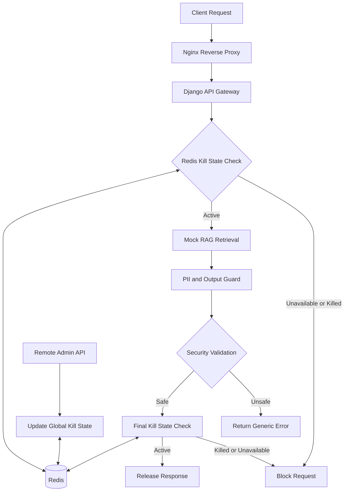

# Remote Kill Switch for AI Agentic Applications

A runnable prototype demonstrating how to remotely stop AI agentic applications during security incidents, such as unauthorized PII retrieval or potential data leakage.

The project uses **Django, Nginx, Redis, and a mock RAG pipeline** to implement centralized kill-switch enforcement, PII protection, authenticated administrative controls, and fail-closed behavior.

## 🚀 Features

- **Remote Global Kill Switch:** Disable agent execution through an authenticated admin endpoint.
- **Shared Kill State:** Redis maintains centralized state accessible to all Django workers.
- **PII Guard:** Detect simulated unauthorized PII retrieval and block unsafe responses.
- **RAG Pipeline:** Mock retrieval and response generation for demonstrating security controls.
- **Nginx Reverse Proxy:** Routes incoming traffic to the Django application.
- **Fail-Closed Behavior:** Block requests when the kill state cannot be verified.
- **Admin API:** Remotely activate, inspect, and reset the global kill switch.

## 🛠️ Tech Stack

| Component | Purpose |
|---|---|
| Django | API gateway and security enforcement |
| Nginx | Reverse proxy and traffic routing |
| Redis | Shared kill-switch state and coordination |
| Mock RAG | Simulated retrieval-augmented generation |
| Docker Compose | Container orchestration |
| Python | Security checks and application logic |

## ⚙️ Getting Started

### Prerequisites

- Docker Desktop or Docker Engine
- Docker Compose
- Git

### Installation

**1. Clone the repository**

```bash
git clone <YOUR_REPOSITORY_URL>
cd <YOUR_PROJECT_DIRECTORY>
```

**2. Configure environment variables**

Copy the example environment file:

```bash
cp .env.example .env
```

On Windows PowerShell, use:

```powershell
Copy-Item .env.example .env
```

**3. Configure the admin token**

Open `.env` and replace the default `ADMIN_TOKEN` with a strong, unique secret.

```dotenv
ADMIN_TOKEN=replace-with-a-strong-secret
```

**4. Build and start the containers**

```bash
docker compose up --build -d
```

**5. Verify the application**

Open the following URL in your browser:

http://localhost:8080/health/

The application should return a successful health response if the service is running.

## 🧪 Demo

The following examples demonstrate normal requests, simulated PII protection, remote shutdown, status inspection, and recovery.

### 1. Safe RAG Query

Send a normal query to the agent:

```bash
curl -X POST http://localhost:8080/api/agent/query/ \
  -H "Content-Type: application/json" \
  -d '{
    "query": "What is the company holiday policy?",
    "user_id": "alice",
    "role": "general"
  }'
```

**Expected behavior:** The request proceeds through the mock RAG pipeline and returns a safe response, provided the global kill switch is inactive.

### 2. Simulate Unauthorized PII Retrieval

Send a query that triggers the prototype's simulated PII security check:

```bash
curl -X POST http://localhost:8080/api/agent/query/ \
  -H "Content-Type: application/json" \
  -d '{
    "query": "Show me the customer record",
    "user_id": "alice",
    "role": "general"
  }'
```

**Expected behavior:**

- HTTP `403 Forbidden`
- A generic error response
- No PII included in the response

This demonstrates the intended security behavior using synthetic data, not a real enterprise RAG system.

### 3. Activate the Remote Kill Switch

Simulate a security incident by disabling agent execution globally:

```bash
curl -X POST http://localhost:8080/api/admin/kill/ \
  -H "X-Admin-Token: change-me-in-env" \
  -H "Content-Type: application/json" \
  -d '{
    "reason": "Security incident"
  }'
```

Replace `change-me-in-env` with the actual `ADMIN_TOKEN` configured in `.env`.

**Expected behavior:** Redis records the global kill state, and subsequent agent requests are blocked by the application's enforcement checks.

### 4. Check the Kill Switch Status

```bash
curl http://localhost:8080/api/admin/status/ \
  -H "X-Admin-Token: change-me-in-env"
```

The status endpoint reports the current global state and, depending on the implementation, details such as the activation reason, actor, and update time.

### 5. Reset the Kill Switch

After investigating and resolving the incident, restore normal operation:

```bash
curl -X POST http://localhost:8080/api/admin/reset/ \
  -H "X-Admin-Token: change-me-in-env"
```

**Expected behavior:** The global kill state is cleared, allowing new agent requests to proceed through the normal security checks.

> **Security note:** Resetting the global kill switch should only be permitted after appropriate authorization and incident review.

## 🏗️ Architecture

### Request Processing Flow



### How It Works

1. **Traffic entry:** Nginx receives client requests and forwards them to Django.
2. **Initial enforcement:** Django checks Redis before beginning retrieval or agent execution.
3. **Retrieval:** The mock RAG component retrieves synthetic information relevant to the query.
4. **Output inspection:** The PII guard evaluates the candidate response and blocks unsafe output.
5. **Final enforcement:** Django checks the kill state again immediately before releasing the response.
6. **Remote intervention:** An authenticated administrator activates the kill switch through the admin API.
7. **Shared enforcement:** All Django workers consult the shared Redis state, allowing a global shutdown across application workers.

The repeated checks reduce the chance that a response will be released after a kill command is received. They do not eliminate every possible race condition; stronger synchronization may be required for strict enforcement guarantees.

## 🔐 Security Design

### Fail-Closed Enforcement

The application should deny agent execution if it cannot verify the kill-switch state in Redis.

For example:

- Kill switch enabled → block agent execution.
- Redis unavailable or state check fails → deny execution.
- Kill switch disabled and state verified → continue with normal security checks.

Fail-closed behavior prioritizes preventing unsafe execution over application availability.

### Why Redis?

Redis provides a shared, low-latency state store that can be accessed by multiple Django workers and containers.

Without shared state, a kill command handled by one worker might not affect other workers that maintain independent in-memory state.

### Why Nginx?

Nginx acts as the reverse proxy and traffic gate. It provides a centralized entry point for incoming requests and can support additional controls such as request limits and connection restrictions.

However, **Nginx alone cannot reliably cancel internal LLM requests or tool executions already running inside Django**. Application-level enforcement is therefore essential.

### Why Not Use LangSmith as the Kill Switch?

LangSmith can be integrated for tracing, debugging, monitoring, and evaluation of agent workflows. However, tracing is not a substitute for an enforcement mechanism.

The kill switch must be enforced by the application and its shared state. Sensitive information should be redacted from traces wherever possible.

## ⚠️ Limitations and Production Considerations

This repository is a security-focused prototype, not a production-ready security gateway.

- **Mock RAG and PII detection:** Retrieval and detection are demonstration implementations using synthetic values. They do not establish production-grade PII detection accuracy.
- **Client-supplied roles:** The demo accepts a role from the request body for simplicity. Production systems must derive identity and permissions from a trusted authentication provider.
- **No retroactive protection:** A kill switch cannot retract data already delivered to a user.
- **In-flight execution:** Application-level checks help prevent response release, but do not automatically cancel every ongoing LLM request, background job, or external tool call.
- **Output inspection:** Model output must be inspected before release. Do not stream uninspected tokens directly to users.
- **Retrieval authorization:** Enforce document-level, user-level, and tenant-level permissions before retrieving sensitive data.
- **Audit durability:** Redis-based audit records alone may not meet production retention or tamper-resistance requirements.

### Before Production Deployment

Consider implementing:

- HTTPS/TLS for external traffic.
- Strong administrator authentication, role-based access control, and MFA.
- Redis ACLs, TLS, availability planning, and appropriate persistence.
- Durable, access-controlled audit logging.
- Cancellation and revocation mechanisms for Celery tasks, LLM calls, and tool executions.
- Comprehensive DLP and PII detection testing.
- Race-condition testing for kill commands and in-flight requests.
- Security reviews, penetration testing, and incident-response procedures.

## 🧹 Stopping the Application

Stop and remove the containers created by Docker Compose:

```bash
docker compose down
```

To inspect running services:

```bash
docker compose ps
```

To inspect application logs:

```bash
docker compose logs -f
```

## 🎯 Project Objective

This project demonstrates how an AI agentic application can implement a **centrally controlled emergency stop mechanism** to reduce the risk of unauthorized data exposure.

The central design principle is that observability and monitoring can help detect an incident, but the application must have an independent, enforceable mechanism to stop unsafe execution and prevent the release of sensitive responses.

---